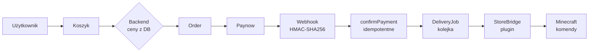

<div align="center">

# ⛏️ mcweb

**Kompletny, self-hosted system webowy dla serwera Minecraft**

Strona główna · Sklep · Konta · Discord · Nagrody · Tickety · Status · Panel admina

[](https://nextjs.org)
[](https://www.typescriptlang.org)
[](https://tailwindcss.com)
[](https://www.prisma.io)
[](https://www.postgresql.org)
[](https://www.docker.com)
[](https://creativecommons.org/licenses/by/4.0/)

Nowoczesny, ciemny, minimalistyczny design inspirowany stylistyką premium — bez przesadnego „minecraftowego" wyglądu. System obsługuje prawdziwe pieniądze (Paynow), z bezpieczną kolejką dostaw do serwera Minecraft przez autorski plugin **StoreBridge**.

</div>

---

## ✨ Funkcje

| Moduł | Opis |
|---|---|
| 🏠 **Strona główna** | Status serwera na żywo, kopiowanie IP, tryby, sezon, FAQ |
| 🛒 **Sklep** | Tryby → kategorie → produkty. Koszyk wysuwany, „kup dla innego gracza" |
| 💳 **Płatności** | Paynow (production / sandbox / **mock** do testów) + idempotentne webhooki |
| 👤 **Konta** | Discord OAuth + Minecraft (Mojang). Jedno konto `User` + linkowanie obu |
| 🎁 **Nagrody** | Wymagania, postęp, odbiór, kody promocyjne, nagroda Media |
| 🎫 **Tickety** | Kategorie, konwersacje, załączniki, statusy |
| 📊 **Status** | Proxy + tryby, TPS, MSPT, ping, uptime, historia, StoreBridge, Discord bot |
| 🛠️ **Panel admina** | Dashboard + pełne CRUD + widok gracza + logi + ustawienia |
| 🔌 **StoreBridge** | Plugin Paper — pobiera dostawy, wykonuje komendy, bez RCON |

## 🚀 Szybki start

```bash
# 1. Sklonuj repozytorium
git clone <repo-url> && cd mcweb

# 2. Skopiuj i uzupełnij env
cp .env.example .env
#   → ustaw: APP_URL, AUTH_SECRET, DATABASE_URL, STOREBRIDGE_SECRET
#   → Paynow/Discord opcjonalnie na start (mock działa bez kluczy)

# 3. Uruchom
docker compose up -d

# 4. Otwórz kreator konfiguracji (tylko raz)
#    http://localhost:3000/setup
```

> [!IMPORTANT]
> Po ukończeniu setup zostaje zablokowany, a Ty zostajesz zalogowany jako właściciel i trafiasz do panelu `/admin`.

<details>
<summary><b>📦 Lokalnie bez Dockera</b></summary>

```bash
npm install
npx prisma db push     # wymaga PostgreSQL pod DATABASE_URL z .env
npm run db:seed        # domyślne kategorie + nagrody (opcjonalnie)
npm run dev
```

</details>

## 🔧 Konfiguracja `.env`

Najważniejsze zmienne (pełna lista w [`.env.example`](.env.example)):

```env
APP_URL=https://twojadomena.pl
AUTH_SECRET=losowy-dlugi-ciag-znakow        # sesje
DATABASE_URL=postgresql://mcweb:mcweb@db:5432/mcweb?schema=public
STOREBRIDGE_SECRET=losowy-dlugi-ciag-znakow # plugin ↔ backend

DISCORD_CLIENT_ID=                          # OAuth (opcjonalnie)
DISCORD_CLIENT_SECRET=

PAYNOW_ENV=mock                            # mock | sandbox | production
PAYNOW_API_KEY=                             # wymagane dla sandbox/production
PAYNOW_API_SECRET=
```

> [!TIP]
> Tryb `PAYNOW_ENV=mock` pozwala przejść cały proces zakupu lokalnie bez kluczy Paynow.

## 🧩 Instalacja krok po kroku

### 1. Pobierz projekt
Pobierz repozytorium lub paczkę ZIP i rozpakuj na VPS/serwerze.

### 2. Skonfiguruj `.env`
```bash
cp .env.example .env
```
Uzupełnij zmienne wg sekcji powyżej. Wszystkie sekrety muszą być długimi, losowymi ciągami.

### 3. Uruchom stronę
```bash
docker compose up -d
```
Docker Compose uruchomi aplikację oraz PostgreSQL. Schemat bazy synchronizowany jest automatycznie przy starcie.

### 4. Kreator konfiguracji
Wejdź na `https://twojadomena.pl/setup`. Kreator ustawi:
- nazwę i IP serwera, logo, kolor akcentu
- Discord, konto administratora
- konfigurację Paynow
- pierwszy tryb i pierwszy produkt

### 5. Zainstaluj StoreBridge
Wgraj `StoreBridge.jar` do `/plugins/` na każdym serwerze Paper. Referencyjny kod pluginu znajdziesz w katalogu [`storebridge/`](storebridge/) (`StoreBridge.java` + `config.yml` + `README.md`).

W `plugins/StoreBridge/config.yml` ustaw:
- `backend-url` — adres strony
- `mode-id` — opcjonalnie ID trybu
- `secret` — ten sam `STOREBRIDGE_SECRET` co w `.env`

> [!NOTE]
> Plugin nie wymaga publicznego RCON. Jeśli serwer Minecraft był offline w momencie zakupu, dostawa czeka w kolejce i zostanie wykonana po starcie. Nick gracza jest walidowany przed podstawieniem do komend.

### 6. Sprawdź status
Wejdź na `/status` — StoreBridge i serwer Minecraft powinny być widoczne jako online.

### 7. Panel administratora
Panel znajdziesz pod `/admin`. Możesz tam zarządzać wszystkim: dashboardem, graczami, zamówieniami, produktami, kategoriami, trybami, nagrodami, ticketami, zgłoszeniami Media, serwerami, Discordem, kodami rabatowymi, logami i ustawieniami.

### 8. Włącz prawdziwe płatności
Po testach zmień na:
```env
PAYNOW_ENV=production
```
i wpisz produkcyjne `PAYNOW_API_KEY` / `PAYNOW_API_SECRET`. Upewnij się, że `APP_URL` wskazuje właściwą domenę (używany do URL powrotu i webhooka).

## 🏗️ Stack

- **Next.js 14** (App Router) + **TypeScript**
- **Tailwind CSS** — ciemny design system z konfigurowalnym kolorem akcentu
- **PostgreSQL 16** + **Prisma 5** ORM
- **Docker / docker-compose** (aplikacja + baza)
- Integracje: **Paynow**, **Discord** (OAuth + bot), **Mojang**, **StoreBridge** (Paper)

## 📁 Struktura projektu

```
src/
├── app/                      # strony + API routes (App Router)
│   ├── (publiczne)          # /, /sklep, /nagrody, /status, /login, /konto, /zamowienie/[id], /setup
│   ├── admin/                # panel admina (guard: ADMIN/OWNER)
│   └── api/                  # auth, checkout, paynow, storebridge, rewards, media, tickets, admin/*
├── components/               # UI + layout + formularze (reusable)
├── config/                   # konfiguracja publiczna (server.ts)
├── lib/                      # utils (cn, formatPLN, timeAgo, tokens)
└── server/                   # logika backendowa
    ├── db.ts                 # Prisma client
    ├── auth.ts               # sesje, requireUser/Staff/Admin
    ├── settings.ts           # repo ustawień (runtime config)
    ├── ratelimit.ts          # rate limiting per-IP
    ├── audit.ts              # audit log
    ├── paynow.ts             # Paynow (mock/sandbox/prod + webhooki + sygnatury)
    ├── storebridge.ts        # kolejka dostaw + claim/report (idempotentne)
    ├── discord.ts            # OAuth + bot REST + webhooki
    ├── mojang.ts             # resolve nick → uuid + walidacja
    ├── order.ts              # checkout (ceny ZAWSZE z DB), kupony, confirmPayment
    └── rewards.ts            # ewaluacja wymagań + claim + redeem
prisma/schema.prisma          # wszystkie modele + relacje + indeksy
storebridge/                  # referencyjny plugin Paper (Java) + config
```

## 💸 Flow zakupu



> [!IMPORTANT]
> Płatność jest potwierdzona **wyłącznie** zweryfikowanym webhookiem — przekierowanie klienta nie jest uznawane.

## 🔄 Statusy

**Płatność:** `CREATED → PENDING → PAID | FAILED | REFUNDED`

**Dostawa (DeliveryJob):** `WAITING → PROCESSING → DELIVERED | FAILED` (FAILED wraca do WAITING = automatyczny retry)

Strona `/zamowienie/[id]` rozdziela status płatności od statusu dostawy — np. `PAID + FAILED` oznacza: pieniądze otrzymane, produkt czeka w kolejce.

## 🔒 Bezpieczeństwo

Projekt obsługuje prawdziwe pieniądze — zastosowano dobre praktyki:

- 🔐 Sekrety wyłącznie w `.env` (server-side). Brak `NEXT_PUBLIC_*` dla danych Paynow
- 💰 **Ceny nigdy z frontendu** — backend pobiera produkt z DB i przelicza koszyk
- 🎟️ **Kupony liczone backendowo** (procent / kwota, limity, ograniczenia tryb/produkt, daty)
- ✅ **Webhook Paynow weryfikowany HMAC-SHA256** (mock pomija — wewnętrzny)
- 🔁 **Idempotencja**: webhook PAID+PAID = no-op; dostawy enqueue'owane raz; `claimToken` blokuje podwójne wykonanie
- 🚫 **Płatność potwierdzona tylko webhookiem** — redirect klienta nie jest uznawany
- ⏱️ Rate limiting logowania (10/min) i checkoutu (8/min)
- 🥇 Hasła admina hashowane **argon2**
- 🍪 Ciasteczka sesji `httpOnly`, `secure`, `sameSite=lax`
- ✅ Walidacja nicku Minecraft (`[A-Za-z0-9_]{3,16}`) przed podstawieniem do komend — anti-injection
- 📝 Audit log dla akcji administracji i zdarzeń krytycznych
- 🔑 StoreBridge ↔ backend uwierzytelniony `STOREBRIDGE_SECRET`

<details>
<summary><b>📊 Modele bazy danych</b></summary>

`User`, `DiscordAccount`, `MinecraftAccount`, `Session`, `AdminUser`, `ServerMode`, `ServerInstance`, `UptimeRecord`, `Category`, `Product`, `Order`, `OrderItem`, `Payment`, `DeliveryJob`, `Reward`, `RewardClaim`, `MediaApplication`, `Ticket`, `TicketMessage`, `Coupon`, `CouponUsage`, `AuditLog`, `Setting`

Pełne relacje i indeksy w [`prisma/schema.prisma`](prisma/schema.prisma).

</details>

## 🔌 StoreBridge

Patrz [`storebridge/README.md`](storebridge/README.md). Plugin pobiera joby z `/api/storebridge/jobs`, wykonuje komendy, zgłasza status do `/api/storebridge/report`. Bez RCON. Jeśli serwer jest offline, dostawa czeka w kolejce.

**Przykład komendy produktu:**
```
lp user {player} parent addtemp vip 30d
```

## 🎨 Design

Ciemny, minimalistyczny design inspirowany stylistyką **slavicwa.rs** — militarny, tactical feel bez przesadnego „minecraftowego" wyglądu.

- **Typografia:** Bebas Neue (display, uppercase, tracking-wide) + Inter (body) + Roboto Condensed (mono)
- **Paleta:** ciemne surface (950→850), steel/surface accent, jeden konfigurowalny kolor akcentu (domyślnie crimson)
- **Efekty:** glow text-shadow na nagłówkach, gradient overlays, noise texture, backdrop-blur na kartach, shine effect na przyciskach
- **Karty:** subtelne obramowania, hover z accent border
- **Animacje:** fade-up, fade-in, pulse, shimmer — lekkie i subtelne
- **Pełna responsywność** mobile/desktop

## 📜 Licencja

**Creative Commons Uznanie autorstwa 4.0 (CC BY 4.0)** © 2026 **morisastro**

Możesz udostępniać, modyfikować i wykorzystywać ten projekt w dowolnym celu (również komercyjnym), **ale wyłącznie z wyraźnym oznaczeniem autora — morisastro**. Pełny tekst licencji: [`LICENSE`](LICENSE) oraz <https://creativecommons.org/licenses/by/4.0/legalcode>

Zalecana forma atrybucji:
> Projekt [mcweb] © morisastro, na licencji CC BY 4.0 — https://creativecommons.org/licenses/by/4.0/

---

<div align="center">

**Gotowe.** Strona, sklep, nagrody, tickety oraz integracje Minecraft + Discord zarządzane z jednego systemu.

</div>
